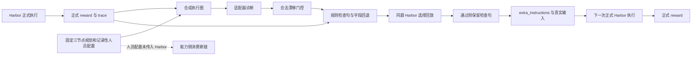

# SkillFlow 系统走查与机制核验

2026-10-13。依据当前源码、正式账本和远端实际工件；机器上的只读检查确认 Qwen3-8B 与当前两份适配器存在，模型机约 20GB、Harbor 机约 30GB 可用。未改主表、协议、模型角色或验证器。

## 已核验的采用与拒绝

字节哈希、完整远端路径、账本行与奖励回执在 [walkthrough.json](walkthrough.json)。该文件由 [audit.py](audit.py) 只读采集；不能用流程设计代替这些工件。

| 轨迹 | 正式执行 | 选择回放 | 下一次执行 / 保留 | 证据范围 |
|---|---|---|---|---|
| Weighted hospital-bedflow | 原 89 字检查，正式奖励 0 | 283 字缓存检查，回放奖励 1 | 后续正式输入确有 283 字检查，奖励 1 | 三个真实 trajectory.json 含对应文本，配置与奖励文件有哈希 |
| DMAIC devops-pipeline | 515 字检查，正式奖励 0 | 89 字候选，回放奖励 0 | 账本仍为 515 字检查 | 两个实际输入与奖励确认；没有把失败回放算成正式通过 |
| Embedded fx-cross-rate | 空更新，正式奖励 0 | 89 字检查，回放奖励 1 | 记录 carry 仍为空 | 显示回放通过与有效冻结物不同；kept 标志不能单独代替消费证据 |

最后一条是配对劣化案例的历史执行证据；它本身不能证明更新导致退步。历史环境、题序和重试不受这里控制。

## 机制边界

1. **能力侧断链。** `janus_full.harbor_once` 调用 `baselines.run_harbor` 时只有检查句；`remote_one_trial.run_trial` 仅把文本装入 extra_instructions。D/S 组队和替换写在 plan / staff 记录中，未被这个任务执行器消费。因此不能把主表解释为已验证 D/S 的任务收益，M4、M9 能力轴当前不可识别。
2. **执行图为合成投影。** `harbor_bridge.execution_graph` 在通过时复制规划图；失败时固定改 work 的 acceptance 与 check 的后果，trace 仅截取 180 字。它不是从逐步工具事件重建的实际执行图。M1 只能检验当前投影信息，而不是直接证明完整双树系统的定位优势。
3. **提案主要由规则生成。** `one_update` 用侦探是否合法漂移作为门控；`check_from_trace` 读取报错产生预写检查，部分族群再按字段回退。当前训练角色不能未经接口核验被称为补丁生成模型。
4. **最小性是文本约束。** 单句与最多 80 个词的校验，没有证明代价最优。本轮 M3 对应放开冗余文本，保留执行回放验收。
5. **正式与回放分离存在。** 原正式失败没有被回放 1 覆盖；后续真正正式执行 1 才进入主表。缓存检查的输入消费有真实轨迹支持。

## 后续可检验问题

独立的 [experiment.json](experiment.json) 登记 32 次 Harbor 执行：2 次共享新 source 证据、12 次候选验收、12 次变体 target、2 次空更新控制、4 次历史冻结检查迁移。所有正式结果另存，不写主表。

M2、M3、M1 是当前文本桥的探索性关键消融。M1 保留节点身份并屏蔽图内容，是显式分布外信息干预；M2 是诊断门控与直接规则的比较。两组 source / target 都已曝光，单次执行不支持显著性或泛化声明。

冻结阶段直接使用已登记字节哈希，目标期间无诊断、无改写、无选择。历史人工 / 规则检查单列来源。若本轮没有采用更新，就报告没有新冻结物，不能用目标成功反向挑选候选。

## 2026-10-13 原生训练契约更正

后续真实权重核验推翻了按定位器理解本适配器的前提：配置里的侦探权重 SHA-256 与最小规划演化训练报告一致，原生输出是 decision/direction/sourceNodeIds/edits。输入为 task、G_plan、G_exec、executionEvidence、catalog、observations；observedWorlds 是案例数据，经过原始 prompt 转换成 observations。旧文本桥及其 32 次 pilot 已停止继续调度；保留的 10 份正式回执只作接口诊断，不能替代原生关键消融或跨 benchmark 结论。

用户选择先补齐原生训练契约，再评完整系统。隔离目录新增真实表格工具：执行前固定初始规划、子任务规格和输入快照，主机执行原有六种算子并写入链式事件回执；已验证的模型补丁实际改变下一次工具执行使用的规划。学习需同时通过公开算子验收、Harbor 正式 reward >= 1 且 error 为空、补丁重放和候选集内最小性检查。规则校验仅作为拒绝器，不用规则答案替代错误模型提案。

目前边界检查通过，真实接口核验正在进行。首次 canary 出现复制示例规格，第二次暴露普通终端输出被拦截器提前消费；均保留回执并作为工程失败，未计作 benchmark 得分或机制成功。已修正说明与输出转发，新增输出保留测试。接口 canary 为自建公开表格任务，与 SkillFlow、Terminal-Bench 正式分数分开。

当前范围仍是有限表格 DSL。输入快照在工具注册时固定，尚不保证发生在 Agent 第一个动作之前；不能把它称为完整任务原始文件防篡改证明。任务子规格由公开要求产生；正式任务通过是额外门控，不能自动证明每个子规格语义正确。超出算子语义的任务不虚构图或漂移。D/S profile 文本已进入实际共享执行器输入的证据只说明输入消费，不说明独立多 Agent 执行或因果收益。

## 2026-10-13 V2 核验进展

上段的注册时快照限制属于 V1。V2 在 Agent 第一个终端动作前，将公开指令明确命名的 CSV/XLSX 原始字节保存在容器不可写的主机目录；工具读取原始快照，派生文件不得作为学习证据。最新自建接口 canary 的正式 reward=1、error 为空，snapshotBeforeFirstAgentAction=true，合格案例 originalInputSnapshot=true。该结果证明接口工作，不代表 SkillFlow 消融或跨 benchmark 提分。未在公开指令中命名的输入不因此取得原始来源资格。

V1 两道源题已完成：03_university_faculty_model reward=1，但子规格把记录数误填为质量阈值，公开 DSL 验收失败；harbor_devops_pipeline_02 reward=0。两者合格原生案例数均为零，回执已保存为 native-source-v1-*，没有写入主表。V2 已修正通用阈值语义说明，并仅采集主表尚未通过的 01_orchestra_foundation_model。不得把整题通过重新标注为补丁模型成功。

旧接口 canary 的原生训练版输出 no_change，未训练版提出候选集外改动并被拒绝；初始规划本来正确，没有真实修复或采用的更新。四个推理臂的案例来源现已保存为独立字节快照，并以原上传 cases.json 的 SHA-256 校验，后续 canary 不会替换历史推理来源。

D/S 配对推理覆盖三个上下文，每个上下文六对画像，两臂共 36 个合法输出。训练与未训练最终均选择 planner/worker/checker，当前画像库没有形成组队行为干预。该结果不支持独立 D/S 因果收益；原生表格补丁契约也未提供经核验的换人触发器。关键消融和跨 benchmark 正式评测仍未完成。

## V3 正式源题与 V4 联机核验

V3 的 02_orchestra_archive_refresh_model 正式 reward=0，03_university_faculty_model 正式 reward=0；两题分别有 103 行、75 行原始快照表格成功执行，初始规划与执行图一致，没有观察到真实修复。faculty 的十个检查中九个通过，剩余服务年限检查存在确定的字符串比较错误：先删除公式中所有空格，再与保留工作表名内空格的期望值比较，使正确的同格 +1 公式也被拒绝。仅修复该比较，保留工作表名、行号与 +1；正确公式及操作符空白通过，错误工作表、错误行、+2 均拒绝。Summary B1、季度合计和年限 +1 要求未改，旧 reward=0 未覆盖，修复回执见 faculty-verifier-comparison-fix.json。

V4 的真实联机接口 canary 正式 reward=1、error 为空。Harbor 读取实际工具执行，经 SSH 请求模型机冻结的原生适配器；模型返回 no_change，经原始独立验证器确认。输入 651 tokens、输出 20 tokens，适配器 SHA-256 为 8755e26df3f370a8396e7acdae6670f2a45c6cdcdbca4ea3d0ce911a059afebc。该自建结果仅证明调用与反馈链工作，不能视作 benchmark 提分，也没有补丁采用证据。

联机决策只在本题内使用，目标正式奖励不进入模型输入，权重不训练，不从目标任务持久化更新。公开 DSL 已成功执行后，模型按原训练契约比较初始规划与实际执行图；不制造错误规划以取得修复案例。最低代价检查仅拒绝不合格提案，不能替模型生成答案。原生模型为 no_change 时，下一次工具执行才可能形成后续消费证据；仅向做题模型反馈验证状态不能标成已执行补丁。

迁移前将按实际输入、更新包和联机模型臂的哈希识别完全相同的变体；未单独运行的相同变体不声称具有独立正式分数，其因果对比记不可识别。范围仍是有限表格补丁与共享执行器内的 D 画像消费，独立多 Agent 与 S 换人触发均未验证。
